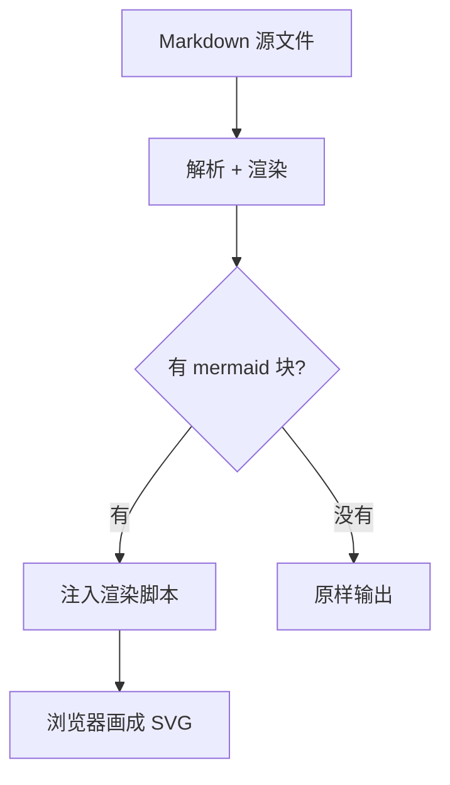
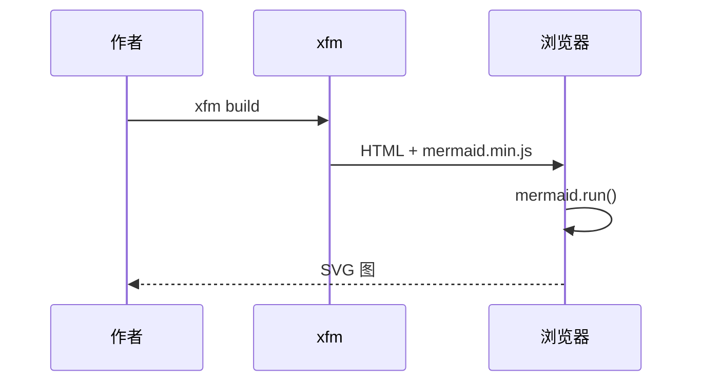

# 数学公式与图表

Markdown 本身只有文本。要写技术文章，迟早会遇到两个需求：**公式**和**图**。
XFM 把它们做成了两个可选插件——装上就有，不装内核还是那个零依赖的小引擎。

```bash
npm i -D xfm-plugin-math xfm-plugin-mermaid
```

装完重启 `xfm dev` 即可，配置文件里不需要写任何注册代码（自动发现机制和 Hexo 一致）。
本文下面的公式与流程图，就是这个示例站启用两个插件后真实渲染出来的。

## 公式：构建期渲染，前端零 JS

行内写法用单个美元符，比如质能方程 $E = mc^2$ 就这样嵌在句子里；
下标、上标、希腊字母都能正常用：$\alpha_1, \beta_2, \gamma^3$。

块级公式用两个美元符：

$$
\int_{0}^{1} x^{2}\,\mathrm{d}x = \frac{1}{3}
$$

多行对齐、矩阵、求和这些也都是 KaTeX 的强项：

$$
\begin{aligned}
\nabla \cdot \mathbf{E} &= \frac{\rho}{\varepsilon_0} \\
\nabla \times \mathbf{B} &= \mu_0 \mathbf{J} + \mu_0 \varepsilon_0 \frac{\partial \mathbf{E}}{\partial t}
\end{aligned}
$$

$$
A = \begin{pmatrix} a & b \\ c & d \end{pmatrix},\qquad
\det A = ad - bc,\qquad
\sum_{n=1}^{\infty} \frac{1}{n^2} = \frac{\pi^2}{6}
$$

**为什么放在构建期**：页面里输出的是 KaTeX 的 HTML 与 CSS，不含任何脚本，
所以首屏不会先闪一下原始 LaTeX 再跳成公式，也不需要从 CDN 拉脚本。
CSS 与字体由插件复制进 `dist/assets/katex/`（默认只带 woff2，约 300KB）。

**它怎么处理下划线**：`$a_1$` 里的 `_` 会被 Markdown 当成强调，所以插件在 Markdown
解析**之前**把公式换成占位符，渲染完成后再换回 KaTeX 的 HTML。占位符用 Unicode
私用区字符，Markdown 不会碰它们。代价是存在 `markdown` 钩子时生产构建不走 worker 池，
只有装了数学插件的站点会受影响。

几个边界：围栏代码块、缩进代码块、行内代码里的 `$` 都不会被当成公式；
`\$` 输出字面美元符号，所以「价格 $5 和 $10」不会被误判。

### 配置

```js
export default {
  math: {
    css: 'local',          // 'local' 复制进产物（默认）| 'cdn' | 'none'
    path: 'assets/katex',
    fonts: 'woff2',        // 'all' 连 woff/ttf 一起复制
    macros: { '\\RR': '\\mathbb{R}' },
    output: 'html',        // 'htmlAndMathml' 更利于读屏软件，体积更大
  },
};
```

## 图表：交给浏览器画

Mermaid 需要 DOM 与真实文本测量，构建期渲染得拉 jsdom 或无头浏览器，
那就不是"零依赖、秒级构建"了。所以它走客户端：围栏代码块转成
`<pre class="mermaid">`，页面里的脚本再把它画成 SVG。



时序图、状态机、甘特图也都是同一套语法：



**只有含图表的页面才会注入脚本**。5MB 的 `mermaid.min.js` 不该拖慢其他页面，
所以插件在 `transformHtml` 里先判断页面有没有 mermaid 块，没有就一个字节都不加。
想要更小的产物，就用 CDN：

```js
export default {
  mermaid: {
    mode: 'local',          // 'local' 自托管（默认）| 'cdn' | 'none'
    theme: 'default',       // default | neutral | dark | forest | base
    securityLevel: 'loose', // 允许 click 交互与 HTML 标签
  },
};
```

页面级关闭也支持：front-matter 写 `mermaid: false`，那一页的代码块就还是普通代码块。

## 两个插件怎么选

| | math | mermaid |
| --- | --- | --- |
| 渲染时机 | 构建期 | 浏览器 |
| 前端 JS | 无 | 有（仅图表页） |
| 产物 | HTML + CSS + 字体 | `<pre>` + 一次脚本执行 |
| 适合 | 大量公式的技术文 | 偶尔画个流程图、时序图 |

公式多就装 math，图多就装 mermaid，两个都装也不冲突——它们改的是页面的不同部分。
