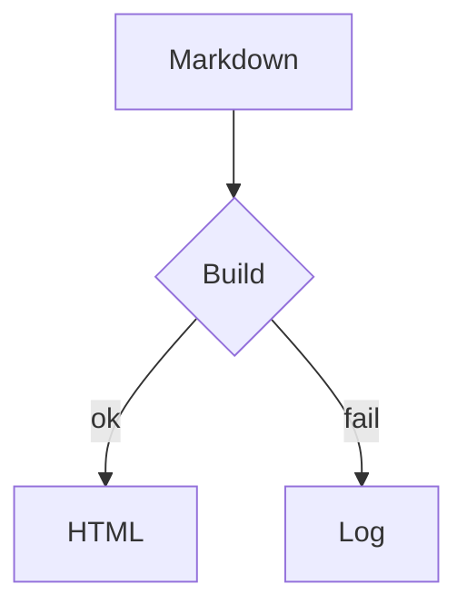

# xfm-plugin-mermaid

Mermaid diagrams for xfmpress — write a fenced `mermaid` block, get a rendered diagram.

Part of [xfm](https://github.com/xfm0797/xfm) — a zero-dependency static site generator for Node.js.
**Plugins are not bundled with the core**: install only the ones you need.

## Install

```bash
npm i -D xfm-plugin-mermaid
```

That is all — the generator loads every `xfm-plugin-*` dependency found in your site's
`package.json` automatically (same as Hexo). Restart `xfm dev` if it is already running.

Explicit configuration also works:

```js
// xfm.config.mjs
export default {
  plugins: ['mermaid'],
};
```

## Usage

````markdown

````

The block becomes `<pre class="mermaid">…</pre>` and the browser turns it into an SVG.
Every Mermaid diagram type works — flowchart, sequence, class, state, ER, gantt, pie,
git graph, mindmap, timeline, quadrant, sankey and the rest.

The renderer script is injected **only on pages that contain a diagram**, so a 5 MB
bundle never slows down the rest of the site.

## Options

```js
export default {
  mermaid: {
    mode: 'local',          // 'local' self-host | 'cdn' | 'none' (bring your own script)
    path: 'assets/mermaid', // output directory when mode: 'local'
    cdn: 'https://cdn.jsdelivr.net/npm/mermaid@12/dist/mermaid.min.js',
    theme: 'default',       // default | neutral | dark | forest | base
    securityLevel: 'loose', // 'loose' allows click handlers and HTML labels; use 'strict' for untrusted content
    option: {},             // merged into mermaid.initialize()
  },
};
```

| | |
| --- | --- |
| Output | `<pre class="mermaid">` inline in the page; `assets/mermaid/mermaid.min.js` when `mode: 'local'` |
| Injection | `<script src>` + a tiny bootstrap calling `mermaid.run()`, before `</body>`, base-aware |
| Hooks | `transformHtml`, `afterBuild` |
| Front-matter | `mermaid: false` — keep the block as a plain code listing on that page |

## Why client-side rendering

Mermaid needs a DOM and real text measurements. Rendering it at build time means pulling
in jsdom or a headless browser — the opposite of "zero dependencies, sub-second builds".
Client-side rendering keeps the build instant and lets diagrams reflow with the page font
and theme.

If you would rather not ship the 5 MB bundle, set `mode: 'cdn'`. The script is then loaded
from jsDelivr and nothing is written into `dist/`.

## Typical output size

`mode: 'local'` writes one file, `mermaid.min.js` (~5 MB uncompressed, ~1.2 MB gzipped).
Most static hosts gzip or brotli it automatically; it is cached by the browser after the
first diagram page.

## License

MIT © xfm0797
