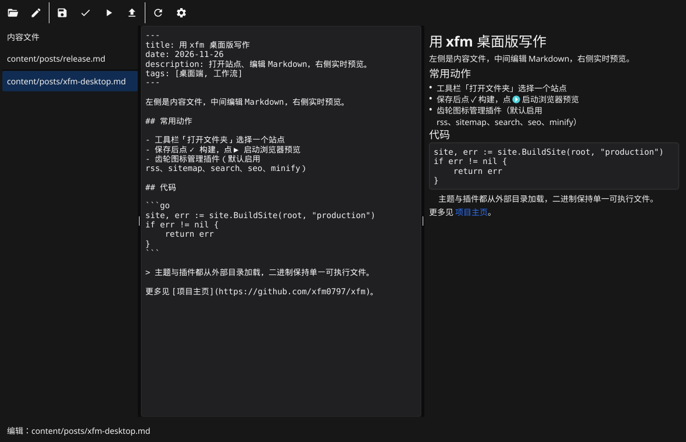
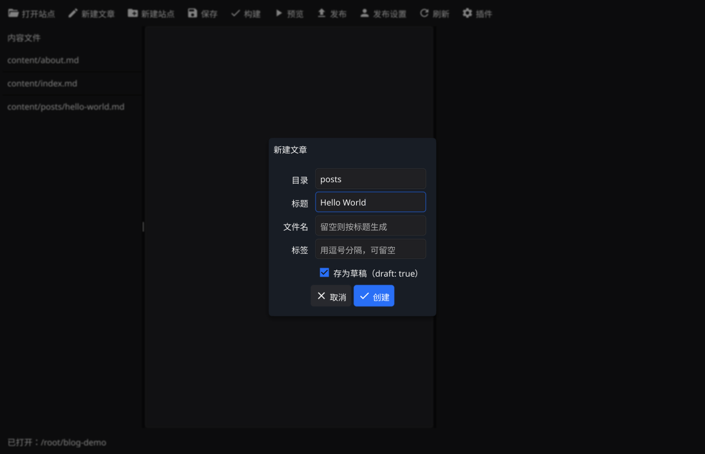
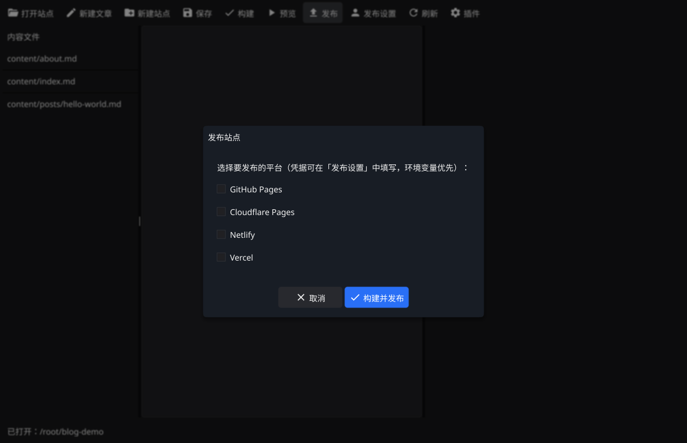

# ⚡ xfm 桌面版

[](https://github.com/xfm0797/xfm/actions/workflows/desktop-release.yml)

基于 [Fyne](https://fyne.io) 的静态博客工作台：**图形界面 + 命令行同一个二进制**，构建内核用纯 Go 重写，与 Node 版 xfm 共用主题与插件约定。



## 功能

- **站点工作台**：打开/新建站点，左侧浏览 `content/` 下的全部 Markdown
- **新建文章**：填标题与标签即生成带 front matter 的 Markdown，并自动打开
- **实时预览**：中间编辑、右侧富文本预览，输入 250ms 防抖
- **一键构建**：工具栏「构建」直接产出 `dist/`，状态栏显示页数、资源数与输出文件数
- **浏览器预览**：构建后启动本地静态服务并打开系统浏览器
- **多平台发布**：构建后一键推送到 GitHub Pages / Cloudflare Pages / Netlify / Vercel
- **发布设置**：图形界面填写各平台仓库、项目与 Token，Token 保存在本机（0600）
- **插件管理**：工具栏「插件」打开面板，勾选即启用，配置写入站点 `plugins/<name>.json`
- **原生图标**：窗口/任务栏使用闪电图标，Windows 可执行文件带同款图标与 DPI 清单
- **外置资源**：主题与插件不嵌入二进制，运行时从搜索路径动态发现

## 下载

从 [Releases](https://github.com/xfm0797/xfm/releases) 获取对应平台压缩包：

| 平台 | 文件 | 内容 |
| --- | --- | --- |
| Linux x86_64 | `xfm-linux-amd64.tar.gz` | `xfm` + `themes/` |
| macOS Apple Silicon | `xfm-darwin-arm64.tar.gz` | `xfm` + `themes/` |
| macOS Intel | `xfm-darwin-amd64.tar.gz` | `xfm` + `themes/` |
| Windows x86_64 | `xfm-windows-amd64.zip` | `xfm.exe` + `themes/` |

解压即可运行；`themes/` 需与可执行文件保持同级，程序会从 `<exe>/themes` 自动加载。

> macOS 首次打开若被 Gatekeeper 拦截，可在「系统设置 → 隐私与安全性」中允许，或执行
> `xattr -dr com.apple.quarantine ./xfm`。Windows 的 SmartScreen 提示同理。

Windows 双击启动时，程序会自动关闭控制台子系统分配的终端窗口；在命令行中运行时输出不受影响。

## 快速开始

不带参数运行即为图形界面：

```bash
./xfm
```

命令行模式：

```bash
xfm create my-blog     # 创建站点（blog / docs 模板）
xfm build my-blog      # 生产构建到 my-blog/dist
xfm serve my-blog      # 构建并启动本地预览（默认 127.0.0.1:4173）
xfm publish my-blog    # 构建并发布到 publish.targets 选定的平台
xfm themes             # 查看主题搜索路径与可用主题
xfm plugins my-blog    # 查看插件启用状态
```

## 新建文章

工具栏「新建文章」→ 填写标题、目录（默认 `posts`）、可选文件名与标签 → 创建后自动打开编辑器。

- 文件路径：`content/<目录>/<slug>.md`，同名时自动追加 `-2`、`-3`
- 标题中的空白转为短横线，保留英文、数字与中文
- 默认勾选「存为草稿」，即写入 `draft: true`，取消勾选则直接发布



## 发布

在站点配置里选择目标平台并填写非敏感参数；凭据可点工具栏「发布设置」保存在本机，也可用环境变量提供（优先级：站点配置 > 环境变量 > 本机保存）。

```json
{
  "publish": {
    "targets": ["github", "cloudflare"],
    "github": { "repo": "owner/repo", "branch": "gh-pages" },
    "cloudflare": { "accountId": "your-account-id", "project": "my-blog", "branch": "main" },
    "netlify": { "siteId": "your-site-id" },
    "vercel": { "project": "my-blog", "teamId": "" }
  }
}
```

| 平台 | 环境变量 | 可选 |
| --- | --- | --- |
| GitHub Pages | `GITHUB_TOKEN` 或 `GH_TOKEN`（缺省时复用本机 git 凭据） | `GITHUB_REPO` |
| Cloudflare Pages | `CLOUDFLARE_API_TOKEN`、`CLOUDFLARE_ACCOUNT_ID` | — |
| Netlify | `NETLIFY_AUTH_TOKEN` | `NETLIFY_SITE_ID` |
| Vercel | `VERCEL_TOKEN` | `VERCEL_TEAM_ID` |

各平台 Token / Site ID 的申请步骤见 [发布凭据申请指南](docs/publish-credentials.md)。

```bash
xfm publish my-blog --dry-run                  # 只校验配置与文件，不上传
xfm publish my-blog                            # 发布到 publish.targets 里的全部平台
xfm publish my-blog --target github,netlify    # 临时指定平台
xfm publish my-blog --message "deploy: 0.1.0"  # GitHub Pages 提交信息
```

单个平台失败不会中断其他平台，命令结束时会汇总成功地址与失败原因。

图形界面：先在工具栏「发布设置」填写 Token 与项目信息（可留空改用环境变量），再点「发布」勾选平台。Token 保存在用户配置目录的 `xfm/publish.json`（权限 `0600`），不会写入站点；完成后弹窗列出各平台地址。



- GitHub Pages 用一次提交强制推送到 `gh-pages` 分支，并自动写入 `.nojekyll`
- Cloudflare Pages 走 Direct Upload：按 sha256 去重后直传，无需先建 CI 流水线
- Netlify 把 `dist` 打成 zip 走 Zip Deploy
- Vercel 通过 v13 Deployments 接口内联上传（`target` 默认 `production`）

## 插件

内置 18 个插件，**核心 5 个默认启用**：`rss`、`sitemap`、`search`、`seo`、`minify`。其余默认关闭，可按需启用。

```bash
xfm plugins my-blog                    # 列出全部插件（● 启用 / ○ 关闭）
xfm plugins my-blog enable math        # 启用数学公式
xfm plugins my-blog disable minify     # 关闭 HTML 压缩
```

也可以直接改配置：

```json
{
  "plugins": ["rss", "sitemap", "search", "seo", "minify", "math", "mermaid"]
}
```

或在站点里放声明式清单 `plugins/math.json`（优先级最高，可覆盖参数、可关闭核心插件）：

```json
{ "name": "rss", "enabled": true, "config": { "limit": 10 } }
```

优先级：`plugins/<name>.json` > `config.plugins` > 默认核心集；写 `"plugins": []` 可全部关闭。

完整插件清单：analytics、comments、deadlinks、feed-json、image-size、llms、math、mermaid、minify、pwa、reading-stats、redirect、related、rss、search、seo、share、sitemap。

## 主题

主题按以下顺序查找，同名以先命中的为准：

1. 环境变量 `XFM_THEMES_DIR`
2. 可执行文件旁的 `themes/`
3. `$XDG_DATA_HOME/xfm/themes`（或 `~/.local/share/xfm/themes`）
4. `~/.xfm/themes`
5. 站点自身的 `themes/`

```bash
xfm install-themes ./themes                      # 安装到用户级缓存
xfm install-themes ./themes ~/my-themes          # 安装到指定目录
XFM_THEMES_DIR=~/my-themes xfm themes            # 临时指定搜索目录
```

## 从源码构建

需要 Go 1.25+；Linux 还需 OpenGL / X11 / Wayland 头文件：

```bash
sudo apt-get install -y libgl1-mesa-dev xorg-dev libwayland-dev libxkbcommon-dev
cd xfm-desktop
go build -trimpath -ldflags "-s -w" -o xfm .
go test ./...
```

### 图标

图标源文件为 `internal/gui/assets/icon.png`（512×512），通过 `go:embed` 用于窗口与任务栏；Windows 的 exe 图标和 DPI 清单来自根目录的 `rsrc_windows_amd64.syso`。修改图标后重新生成：

```bash
go install github.com/akavel/rsrc@latest
convert internal/gui/assets/icon.png -define icon:auto-resize=256,128,64,48,32,16 \
  internal/gui/assets/icon.ico
"$(go env GOPATH)/bin/rsrc" -manifest build/windows/xfm.exe.manifest \
  -ico internal/gui/assets/icon.ico -arch amd64 -o rsrc_windows_amd64.syso
```

## 桌面端发布

推送 `desktop-v*`（或 `v*`）标签会触发 [Desktop Release](../.github/workflows/desktop-release.yml)：在 Linux / macOS（arm64 + amd64）/ Windows 上编译，并把四个平台包附加到 GitHub Release。

```bash
git tag desktop-v0.1.2 && git push origin desktop-v0.1.2
```

用 `desktop-` 前缀可以避免与 Node 版 xfm 的 `v*` 标签冲突。

## 许可证

[MIT](../LICENSE)
